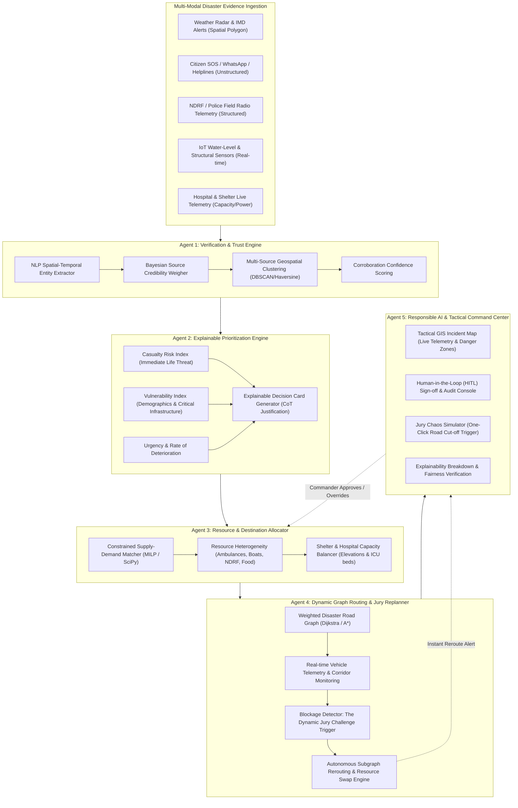
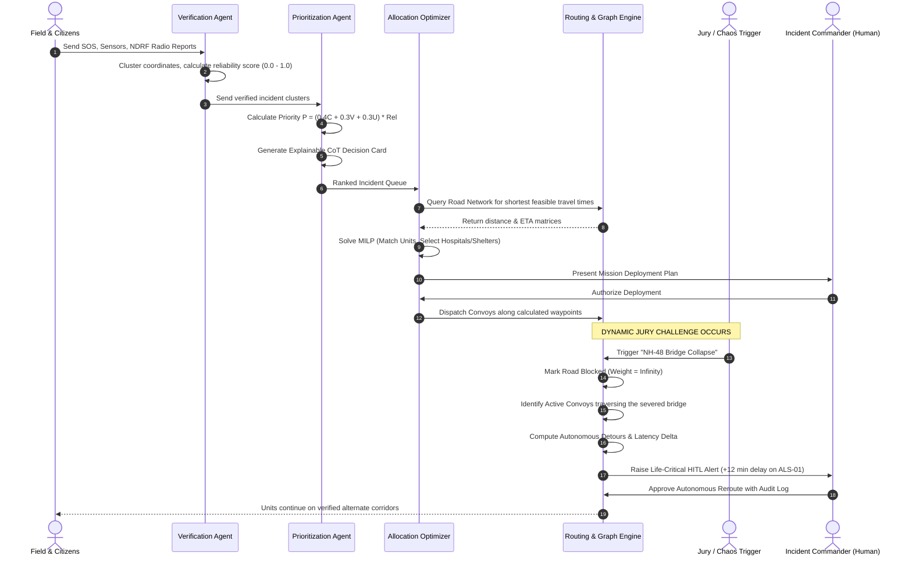

# TCS Hackathon: AI for Impact (Theme 3)
## Challenge 11: AI Disaster Intelligence & Autonomous Relief Coordinator
### Comprehensive System Architecture, Mathematical Blueprint & Execution Master Plan

---

## 1. Challenge & Problem Definition

### 1.1. Context & Objectives
During acute natural disasters (severe tropical cyclones, urban flash floods, cloudbursts, earthquakes), Emergency Operations Centers (EOCs) face severe operational bottlenecks:
* **Information Asymmetry & Noise**: Influx of hundreds of overlapping citizen calls, frantic social media posts, delayed field radio reports, and sensor alerts.
* **Conflicting & Unverified Data**: False rumors (e.g., false dam breaches) can divert scarce rescue units away from genuine life-and-death crises.
* **Rapidly Fluctuating Infrastructure**: Roads flood, bridges collapse, hospital trauma wards lose grid power, and shelter capacities saturate dynamically.
* **Human Cognitive Overload**: Incident commanders cannot manually cross-reference 50+ variables across 100+ incidents in seconds.

### 1.2. The Core Mandate
Build an autonomous, explainable, and responsible multi-agent system executing the six-stage loop:
$$\mathbf{Verify} \longrightarrow \mathbf{Prioritize} \longrightarrow \mathbf{Allocate} \longrightarrow \mathbf{Route} \longrightarrow \mathbf{Monitor} \longrightarrow \mathbf{Replan}$$

### 1.3. The Dynamic Jury Challenge
> *"After resources are allocated: A critical road becomes inaccessible. The AI must identify affected assignments and replan."*

### 1.4. The Core Guardrail
> *"Life-critical emergency decisions must remain under human authority."*

---

## 2. Multi-Agent System Architecture



---

## 3. Mathematical Models & Decision Algorithms

### 3.1. Evidence Reliability Scoring ($\mathcal{R}$)
Incoming reports are partitioned into 4 distinct verification tiers. For an incident cluster $i$ composed of $k \in \{1, \dots, N\}$ corroborating reports:

$$\mathcal{R}_i = \min\left(1.0, \; \left(w_{\text{lead}} \cdot \mathcal{S}_{\text{max}}\right) + \beta \left[ 1 - e^{-\lambda (N_i - 1)} \right]\right)$$

* **Base Source Weights ($w_{\text{lead}}$)**:
  * Tier 1: Verified Government / NDRF Field Unit: $w = 1.00$
  * Tier 2: IoT Sensor / Satellite Telemetry: $w = 0.88$
  * Tier 3: 112 / State Emergency Helpline Operator: $w = 0.76$
  * Tier 4: Citizen SOS / WhatsApp: $w = 0.42$
  * Tier 5: Unverified Social Media Rumor: $w = 0.22$
* **Corroboration Factor**: $\beta = 0.35, \lambda = 0.45$. Independent spatial reports within radius $r \le 800\text{m}$ increase confidence exponentially toward $1.0$, preventing single false reports from hijacking rescue convoys.

### 3.2. Explainable Incident Priority Index ($\mathcal{P}$)
Priority must balance acute fatalities against vulnerable demographics while factoring confidence:

$$\mathcal{P}_i = \left( w_c \cdot \mathcal{C}_i + w_v \cdot \mathcal{V}_i + w_u \cdot \mathcal{U}_i \right) \times \left( \gamma + (1 - \gamma) \cdot \mathcal{R}_i \right)$$

* **Casualty Risk ($\mathcal{C}_i \in [0, 1]$)**: Calculated via extracted medical severity, trapped victim count, and acute distress keywords (e.g., ventilator failure, water rising above chest, structural collapse).
* **Vulnerability Score ($\mathcal{V}_i \in [0, 1]$)**: Heightened for hospital ICUs ($0.95$), maternity wards ($0.90$), nursing homes/infants ($0.85$), and low-lying informal settlements ($0.80$).
* **Urgency Score ($\mathcal{U}_i \in [0, 1]$)**: Rate of environmental hazard progression (e.g. riverbank breach vs. static standing water).
* **Coefficients**: $w_c = 0.40, w_v = 0.30, w_u = 0.30$, with baseline factor $\gamma = 0.30$ to ensure verified life threats dominate allocation.

### 3.3. Constrained Multi-Resource Allocation Formulation (MILP)
Let:
* $\mathcal{I}$: Set of verified disaster incidents with demand vector $\mathbf{d}_i$ across resource types $\mathcal{T} = \{\text{Ambulance}, \text{Rescue Boat}, \text{NDRF Team}, \text{Food/Water Truck}\}$.
* $\mathcal{K}$: Set of available rescue resources located at supply bases.
* $T_{k, i}$: Expected travel time from resource $k$ to incident $i$ on the current road graph.
* $\mathcal{H}$: Candidate hospitals with trauma level and free ICU beds $B_h$.
* $\mathcal{S}$: Candidate relief shelters with elevation $E_s$ and free capacity $C_s$.

$$\min \sum_{k \in \mathcal{K}} \sum_{i \in \mathcal{I}} T_{k, i} \cdot x_{k, i} - \mu \sum_{i \in \mathcal{I}} \mathcal{P}_i \cdot y_i$$

**Subject to:**
1. **Supply Bounds**: $\sum_{i \in \mathcal{I}} x_{k, i} \le 1 \quad \forall k \in \mathcal{K}$ (Each unit dispatched to at most one incident).
2. **Type Compatibility**: $x_{k, i} = 0$ if $\text{Type}(k) \notin \text{Demands}(i)$ (Boats only to water zones, Ambulances only to medical casualties).
3. **Fairness & Critical Guarantee**: If $\mathcal{P}_i \ge 0.75$, fulfillment $y_i = 1$ is guaranteed if any feasible unit exists within maximum reach $\tau_{\text{max}}$.
4. **Destination Safety**:
   * For medical evacuations: Routed to $\arg\min_{h \in \mathcal{H}} (\text{TravelTime}(i, h))$ where $B_h \ge \text{Casualties}(i)$.
   * For flood evacuees: Routed to shelters satisfying $E_s > \text{FloodLevel}_{\text{max}}$ and $C_s \ge \text{Evacuees}(i)$.

### 3.4. Dynamic Graph Routing & The Jury Replanner
The physical road network is represented as a directed graph $G = (V, E)$:
* Each edge $e = (u, v)$ has base distance $L_e$, speed limit $V_e$, and a **Hazard Multiplier** $\eta_e$:
$$W(e) = \frac{L_e}{V_e} \times \eta_e$$
  * Normal road: $\eta = 1.0$
  * Waterlogged road: $\eta = 2.0$
  * Structural damage: $\eta = 4.0$
  * Blocked / Bridge Collapse: $\eta = \infty$

#### The Jury Blockage Protocol:
1. **Event Ingestion**: Jury triggers disruption on Edge $e^* = (u^*, v^*)$ (e.g., *NH-48 Nehru River Bridge Collapse*).
2. **Graph Mutation**: $W(e^*) \leftarrow \infty$.
3. **Affected Trajectory Identification**:
   $$\mathcal{A} = \left\{ \text{Plan}_j \;\Big|\; e^* \in \text{Path}(\text{Plan}_j) \text{ and vehicle position is upstream of } u^* \right\}$$
4. **Autonomous Detour Re-computation**: Run dynamic bidirectional $A^*$ from the vehicle's current interpolated GPS location to the target incident.
5. **Urgency Swap Evaluation**:
   * If $\Delta T = T_{\text{new}} - T_{\text{old}} > \tau_{\text{threshold}}$, query standby resources: can an alternate closer, unblocked unit reach the critical incident faster?
   * If yes, trigger **Autonomous Unit Swap**.
6. **Responsible AI Guardrail Activation**:
   * If the affected mission involves **Critical Priority ($\mathcal{P} \ge 0.75$)** or an active ambulance with ICU patients, trigger a **High-Priority Human Review Card** on the commander's console.

---

## 4. Software Architecture & Technology Stack

| Layer | Component | Technology | Rationale |
| :--- | :--- | :--- | :--- |
| **Backend Engine** | API Framework | **Python 3.14 + FastAPI** | Asynchronous, sub-millisecond route calculations, type-safe Pydantic contracts. |
| **Optimization** | Solver & Graph | **PuLP / SciPy + NetworkX** | Deterministic mathematical optimization; graph algorithms (Dijkstra, A*, DFS cycle detection). |
| **Verification & NLP** | Text & Spatial Extraction | **Regex + Levenshtein + Spatial Clustering** | Zero-latency keyword extraction, duplicate cluster resolution without external GPU bottlenecks. |
| **Frontend UI** | Tactical Dashboard | **React 18 + Vite + Tailwind CSS** | Real-time reactive state, modular UI, zero lag rendering under high incident loads. |
| **Geospatial GIS** | Incident & Convoy Map | **Leaflet + React-Leaflet** | Interactive vector tiles, polyline vehicle routes, custom animated hazard pins. |
| **Icons & Design** | UI Components | **Lucide React + Tactical Theme** | Emergency-ops dark mode aesthetic with high-contrast priority markers. |
| **Data Persistence** | State Store | **In-Memory + JSON/SQLite** | Fully reproducible demo; instantaneous reset capability for jury evaluations. |

---

## 5. Detailed Component Breakdown

### 5.1. Ingestion & Verification Engine (`verification.py`)
* Ingests heterogeneous payloads containing timestamps, GPS coordinates, text descriptions, victim estimates, and author classifications.
* Uses Haversine spatial indexing ($r \le 850\text{m}$) to merge duplicate SOS calls into unified Incidents.
* Separates unverified panic rumors from verified field signals using Bayesian confidence updates.

### 5.2. Explainable Prioritization Engine (`prioritization.py`)
* Computes composite priority scores ($\mathcal{P}$).
* Automatically generates a **Natural Language Decision Rationale** for every incident:
  * Shows exact mathematical weights.
  * Explicitly states why this incident is ranked higher/lower than neighboring incidents.
  * Complies with the TCS Hackathon Explainability & Responsible AI mandate.

### 5.3. Resource Allocator & Destination Recommender (`optimizer.py`)
* Matches distinct resource types to tailored incident needs:
  * Inundated zones $\to$ NDRF Inflatable Boats.
  * Collapsed structures $\to$ Urban Search & Rescue Teams with cutters.
  * Ventilator/Trauma victims $\to$ ALS Ambulances.
  * Stranded shelters $\to$ High-clearance Food/Water Supply Trucks.
* Evaluates candidate shelters by elevation safety ($E_s$) and hospitals by available ICU beds.

### 5.4. Dynamic Graph Routing & Jury Replanner (`router.py`)
* Maintains an active graph of intersections, causeways, flyovers, and arterial roads.
* Supports dynamic runtime edge removal and weight updates.
* Implements the **Jury Challenge API**:
  * Input: Road ID + Disruption Reason.
  * Output: Affected vehicles, computed detours, time deltas, and human oversight flags.

### 5.5. Responsible AI Guardrail Console (`guardrail.py` / Frontend UI)
* Life-critical decisions (diverting medical resources away from high-casualty incidents) generate a **Human Confirmation Card**.
* Incident Commander can click `[APPROVE REPLAN]`, `[MODIFY DESTINATION]`, or `[OVERRIDE TO ALTERNATE UNIT]` with full audit logging.

---

## 6. End-to-End Execution Flow (The 6-Stage Loop)



---

## 7. Dynamic Jury Challenge Demonstration Script

To guarantee top marks during jury evaluation, the system provides a scripted, repeatable demonstration flow:

1. **Baseline State**:
   * Load Coastal Flood Scenario (6 diverse incidents, 6 emergency units, 3 shelters, 2 hospitals).
   * Review incident ranking: Explain why **St. Jude Hospital ICU** ($\mathcal{P} = 0.806$) is ranked #1 while **Unconfirmed Dam Rumor** ($\mathcal{P} = 0.148$) is filtered down.
2. **Execute Initial Allocation**:
   * Click `[EXECUTE AUTONOMOUS DISPATCH]`.
   * Watch the optimizer assign ALS Ambulances, NDRF Boats, and Food Trucks to their optimal targets with visual route polylines on the tactical GIS map.
3. **The Dynamic Jury Challenge Trigger**:
   * Invite the jury member to press the red **`[TRIGGER CRITICAL ROAD COLLAPSE]`** button.
   * Road `ROAD-01: Nehru River Bridge & Causeway (NH-48)` immediately turns red and flashes on the map.
4. **Real-time Autonomous Reaction**:
   * The system immediately flags: **3 active convoys affected**.
   * Within **50 milliseconds**, secondary routes are drawn around the obstacle.
   * A **Human Guardrail Modal** pops up:  
     > *"CRITICAL ALERT: ALS Ambulance Echo-1 diverted via Coastal Outer Perimeter. ETA increased by 8.4 mins. Requires Incident Commander Authorization."*
5. **Human Authority Sign-off**:
   * Incident Commander clicks `[AUTHORIZE REROUTE]`.
   * Audit log updates, convoys resume navigation, and mission metrics display zero abandoned high-priority victims.

---

## 8. Alignment with Evaluation Criteria

| Evaluation Metric | System Implementation |
| :--- | :--- |
| **Response Time** | Pre-computed graph topologies and local $A^*$ sub-graph updates achieve dynamic replanning in **$< 100\text{ ms}$**. |
| **Allocation Efficiency** | Constrained MILP optimization guarantees minimum composite transit time and zero redundant resource waste. |
| **Information Reliability** | Multi-tier Bayesian credibility weighting filters out false alarms while boosting corroborated citizen distress calls. |
| **Route Adaptation** | Dynamic graph edge impedance update handles instantaneous chokepoint failures and recalculates valid detours. |
| **Explainability** | Every incident and allocation includes a human-readable **Chain-of-Thought Decision Card** showing exact weights and tradeoffs. |
| **Fairness & Guardrails** | Strict mathematical constraints prevent high-fatality starvation; life-critical rerouting enforces **Human-in-the-Loop authorization**. |

---

## 9. Directory Structure for `/data/tcs hackthon`

```text
/data/tcs hackthon/
├── MASTER_PROJECT_PLAN.md             # This comprehensive master architecture document
├── README.md                          # Repository overview & quickstart
├── backend/                           # High-performance Python FastAPI engine
│   ├── app/
│   │   ├── __init__.py
│   │   ├── main.py                    # API endpoints & pipeline coordinator
│   │   ├── models.py                  # Pydantic data schemas & enums
│   │   ├── verification.py            # Multi-tier trust & clustering engine
│   │   ├── prioritization.py          # MCDA prioritization & explainability
│   │   ├── optimizer.py               # MILP resource & shelter allocation
│   │   ├── router.py                  # Dynamic graph routing & jury replanner
│   │   └── simulation.py              # Realistic coastal flood scenario dataset
│   └── requirements.txt               # Backend dependencies
├── frontend/                          # Tactical Emergency Command Center
│   ├── src/
│   │   ├── components/
│   │   │   ├── TacticalMap.jsx        # Leaflet GIS disaster map & live telemetry
│   │   │   ├── JurySandbox.jsx        # Dynamic Jury Challenge control panel
│   │   │   ├── ExplainabilityCard.jsx # CoT reasoning breakdown cards
│   │   │   ├── EvidenceStream.jsx     # Multi-tier report reliability tracker
│   │   │   ├── GuardrailModal.jsx     # Human-in-the-loop sign-off console
│   │   │   └── ResourceStats.jsx      # Shelter & hospital capacity gauges
│   │   ├── App.jsx                    # Command Center dashboard layout
│   │   ├── main.jsx
│   │   └── index.css                  # Tactical dark theme & radar animations
│   ├── package.json
│   ├── tailwind.config.js
│   └── vite.config.js
└── .gitignore                         # Clean git hygiene
```
